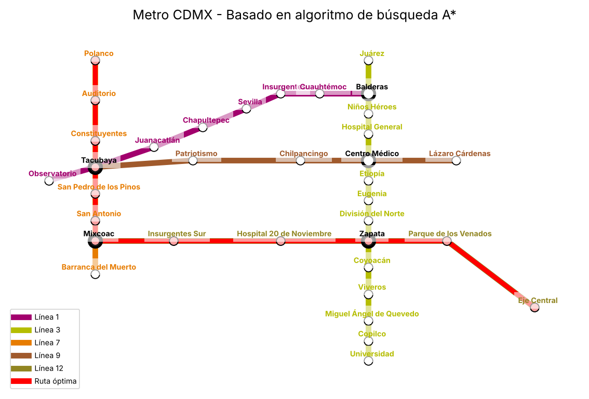
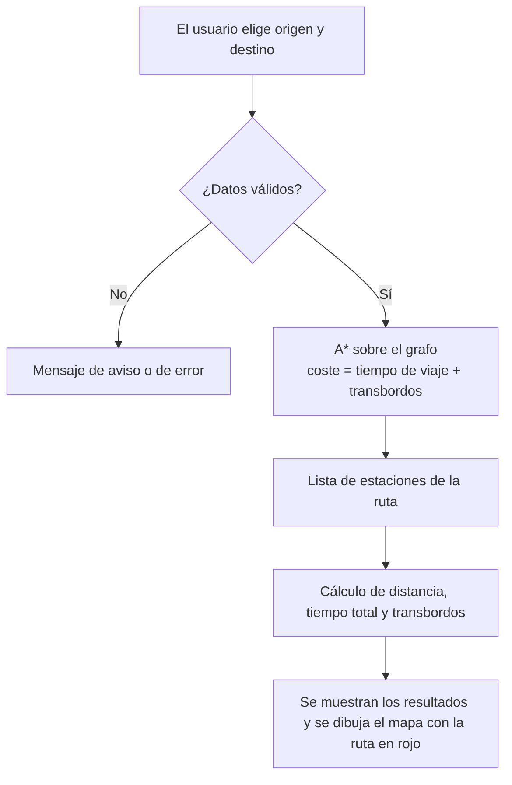
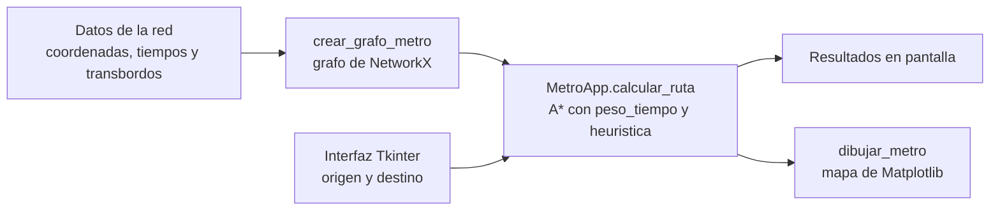

# Metro CDMX: planificador de rutas con el algoritmo A*

Aplicación de escritorio en Python que calcula la ruta entre dos estaciones del Metro de la Ciudad de México usando el algoritmo de búsqueda **A\***. La red se modela como un grafo en el que cada tramo tiene una distancia y un tiempo de viaje, y los transbordos entre líneas suman un tiempo adicional. El resultado se muestra sobre un mapa con la ruta resaltada, junto con la distancia, el tiempo total y el número de transbordos.



## Índice

- [Descripción](#descripción)
- [Funcionalidades](#funcionalidades)
- [Tecnologías](#tecnologías)
- [Red de metro modelada](#red-de-metro-modelada)
- [Funcionamiento](#funcionamiento)
- [Arquitectura](#arquitectura)
- [Interfaz](#interfaz)
- [Ejemplos de resultados](#ejemplos-de-resultados)
- [Instalación y ejecución](#instalación-y-ejecución)

## Descripción

Moverse por una red de metro con varias líneas y estaciones de transbordo es un problema clásico de búsqueda de caminos: dadas una estación de origen y una de destino, hay que decidir por qué estaciones pasar y dónde cambiar de línea para que el viaje sea lo más corto posible.

Este proyecto lo resuelve de la siguiente manera:

1. **Modela la red como un grafo.** Cada estación es un nodo y cada tramo entre dos estaciones consecutivas es una arista con su distancia, su tiempo de viaje y su línea.
2. **Busca la ruta con A\*.** Es un algoritmo de búsqueda informada que explora primero las estaciones más prometedoras, combinando el coste ya recorrido con una estimación de lo que falta. Aquí el coste es el **tiempo de viaje**, e incluye el tiempo que se pierde en cada transbordo.
3. **Presenta el resultado de forma visual.** Una interfaz gráfica permite elegir las estaciones y muestra la ruta, la distancia, el tiempo total, los transbordos y un mapa esquemático de la red con la ruta marcada en rojo.

## Funcionalidades

- **Selección de origen y destino** mediante dos desplegables con las 35 estaciones de la red, ordenadas alfabéticamente. Los campos también admiten texto escrito a mano.
- **Cálculo de la ruta** entre cualquier pareja de estaciones, teniendo en cuenta los tiempos de cada tramo y los de los transbordos.
- **Resultados detallados**: secuencia de estaciones, distancia total en metros, tiempo total en formato `mm:ss`, número de transbordos y tiempo extra que suponen.
- **Mapa de la red** con los colores de cada línea, las estaciones de transbordo destacadas, los nombres de las estaciones, una leyenda y la ruta calculada resaltada en rojo.
- **Validación de las entradas**: avisa si falta el origen o el destino, y muestra un error si se escribe una estación que no existe.

## Tecnologías

| Tecnología | Uso |
|---|---|
| Python 3 | Lenguaje |
| NetworkX | Representación del grafo y algoritmo A* (`astar_path`) |
| Matplotlib | Dibujo del mapa y de la ruta |
| Tkinter (`tk` y `ttk`) | Interfaz gráfica: ventana, desplegables, botón y etiquetas |

Matplotlib se integra dentro de la ventana de Tkinter mediante `FigureCanvasTkAgg`, de modo que el mapa se redibuja en la propia aplicación cada vez que se calcula una ruta.

## Red de metro modelada

La aplicación no recoge toda la red del metro, sino un **subconjunto de 5 líneas**, con **35 estaciones y 36 tramos**. En cada línea se modela solo una parte del recorrido real, y el conjunto forma un grafo conexo.

| Línea | Color | Tramo modelado | Estaciones | Tramos |
|---|---|---|---|---|
| Línea 1 | Morado | Observatorio - Balderas | 8 | 7 |
| Línea 3 | Verde lima | Universidad - Juárez | 14 | 13 |
| Línea 7 | Naranja | Barranca del Muerto - Polanco | 8 | 7 |
| Línea 9 | Marrón | Tacubaya - Lázaro Cárdenas | 5 | 4 |
| Línea 12 | Verde oscuro | Mixcoac - Eje Central | 6 | 5 |

### Datos de cada tramo

Cada tramo del grafo guarda tres atributos:

| Atributo | Contenido |
|---|---|
| `weight` | Distancia entre las dos estaciones, en metros. La red completa suma 32.506 m. |
| `tiempo` | Tiempo de viaje entre las dos estaciones, en segundos (entre 100 y 200 s por tramo). |
| `linea` | Línea a la que pertenece el tramo. |

Además, cada estación tiene unas **coordenadas gráficas** `(x, y)` que fijan su posición en el mapa esquemático. No son coordenadas geográficas: el mapa es un esquema, no está a escala.

### Estaciones de transbordo

Cinco estaciones conectan varias líneas. Cada una es un único nodo del grafo, compartido por las líneas que se cruzan en ella, y la aplicación tiene tabulado el tiempo de cada cambio:

| Estación | Cambio de línea | Tiempo de transbordo |
|---|---|---|
| Tacubaya | Línea 1 ↔ Línea 7 | 2:56 (176 s) |
| Tacubaya | Línea 1 ↔ Línea 9 | 6:22 (382 s) |
| Tacubaya | Línea 7 ↔ Línea 9 | 4:32 (272 s) |
| Mixcoac | Línea 7 ↔ Línea 12 | 5:10 (310 s) |
| Balderas | Línea 1 ↔ Línea 3 | 2:32 (152 s) |
| Centro Médico | Línea 3 ↔ Línea 9 | 1:40 (100 s) |
| Zapata | Línea 3 → Línea 12 | 5:10 (310 s) |
| Zapata | Línea 12 → Línea 3 | 7:00 (420 s) |

En Zapata el tiempo depende del sentido del cambio. En el resto de estaciones es el mismo en ambos sentidos.

## Funcionamiento



### El algoritmo A*

A\* recorre el grafo partiendo del origen. En cada paso expande la estación con menor valor de `f(n) = g(n) + h(n)`, donde:

- **`g(n)`** es el coste real acumulado desde el origen hasta la estación `n`. Aquí es el tiempo de viaje en segundos, más el tiempo de los transbordos realizados.
- **`h(n)`** es una estimación del coste que falta hasta el destino. Es la **heurística**, y orienta la búsqueda hacia el destino.

La búsqueda termina cuando la estación de destino es la siguiente en expandirse. Si la heurística no sobreestima nunca el coste real (es *admisible*), A\* devuelve la ruta de menor coste. En el proyecto se invoca con la función de NetworkX:

```python
ruta = nx.astar_path(grafo, origen, destino, heuristic=heuristica, weight=self.peso_tiempo)
```

### Función de coste: tiempo de viaje y transbordos

El coste de recorrer un tramo lo calcula el método `peso_tiempo`:

- Si el tramo pertenece a la **misma línea** que el tramo anterior, el coste es el `tiempo` del tramo.
- Si el tramo es de **otra línea**, se detecta un transbordo y al `tiempo` del tramo se le suma el tiempo de transbordo de esa estación y de ese par de líneas, tomado de la tabla `tiempos_transbordo`. Si el cambio no estuviese en la tabla, se usan 120 s por defecto (en la red actual todos los cambios están definidos).

Para saber cuál era la línea del tramo anterior, la función guarda la última línea evaluada en `self._linea_prev`, que se reinicia antes de cada búsqueda.

### Heurística

La heurística `heuristica(a, b)` es la **distancia euclídea** entre las coordenadas gráficas de dos estaciones:

```python
math.hypot(x1 - x2, y1 - y2)
```

Las coordenadas están en unidades del dibujo (el valor máximo entre dos estaciones es 23,3) y los costes están en segundos (entre 100 y 2.977 s). Por eso la heurística es muy conservadora: nunca sobreestima el coste real, y en las 1.190 combinaciones de origen y destino no pasa del 4 % de este. Es admisible, aunque aporta poca información de guía y la búsqueda se parece a la del algoritmo de Dijkstra.

### Datos que se muestran

| Dato | Cómo se obtiene |
|---|---|
| **Ruta** | Secuencia de estaciones que devuelve `astar_path`, separadas por `->`. |
| **Distancia** | Suma de los `weight` (metros) de los tramos de la ruta, con `nx.path_weight`. |
| **Tiempo total** | Suma de los `tiempo` de los tramos más el tiempo de los transbordos, calculados con `calcular_tiempo_transbordos` sobre la ruta final. Se muestra como `mm:ss`. |
| **Transbordos** | Número de veces que cambia la línea a lo largo de la ruta, con el tiempo extra que suponen. |

## Arquitectura

Todo el programa está en un único fichero, `metro_aestrella.py`, organizado en bloques con responsabilidades separadas:



| Elemento | Tipo | Responsabilidad |
|---|---|---|
| `coordenadas_graficas` | Diccionario | Posición `(x, y)` de cada estación en el mapa. Se usa para dibujar y para la heurística. |
| `tiempos_entre_estaciones` | Diccionario | Tiempo de viaje, en segundos, de cada tramo. |
| `tiempos_transbordo` | Diccionario | Tiempo de transbordo por estación y par de líneas. |
| `crear_grafo_metro()` | Función | Construye el grafo de NetworkX con sus tramos y devuelve también el color de cada línea. |
| `heuristica(a, b)` | Función | Distancia euclídea entre dos estaciones. |
| `dibujar_metro(ax, grafo, colores, ruta)` | Función | Dibuja el mapa de la red y, si se le pasa una ruta, la resalta. |
| `calcular_tiempo_transbordos(...)` | Función | Cuenta los transbordos de una ruta y suma su tiempo. |
| `MetroApp` | Clase | Interfaz gráfica. Incluye `peso_tiempo` (el coste para A*), `calcular_ruta` (acción del botón) y `cerrar`. |
| `main()` | Función | Crea la ventana y arranca el bucle de eventos de Tkinter. |

### Modelo del grafo

El grafo es un `nx.Graph` **no dirigido**: los tramos se pueden recorrer en ambos sentidos. Los nodos son los nombres de las estaciones y cada arista lleva los atributos `weight`, `tiempo` y `linea`. Las estaciones de transbordo son un único nodo del que salen aristas de varias líneas, y es ahí donde se detecta el cambio de línea.

### Estructura del repositorio

```
metro-cdmx-aestrella/
├── metro_aestrella.py       Programa completo
├── requirements.txt         Librerías necesarias
├── README.md                Esta descripción
├── INSTALACION.md           Instalación y ejecución
└── docs/
    └── mapa-ruta.png        Imagen del mapa usada en este documento
```

## Interfaz

La ventana, de 1150 x 750 píxeles, se compone de:

- **Selectores de origen y destino**: dos desplegables con todas las estaciones y un botón verde **Calcular Ruta**.
- **Panel de resultados** con tres etiquetas: `Ruta`, `Distancia y tiempo total` y `Transbordos`.
- **Mapa de la red**, integrado en la ventana:
  - Cada línea se dibuja con su color.
  - Las estaciones normales son círculos blancos, y las de transbordo son más grandes y con el borde más grueso.
  - Los nombres de las estaciones se muestran con el color de su línea (en negro los de transbordo).
  - La leyenda indica el color de cada línea y el de la ruta.
  - La ruta calculada se dibuja en rojo, con sus estaciones en rosa.

Si falta el origen o el destino, se muestra un aviso (`Selecciona origen y destino`), y si la estación escrita no existe, un error (`La estación de origen 'X' no existe.`).

## Ejemplos de resultados

Texto que muestra la aplicación en el panel de resultados para tres pares de estaciones.

**Observatorio a Balderas.** Todo el recorrido es por la Línea 1, sin transbordos.

```
Ruta: Observatorio -> Tacubaya -> Juanacatlán -> Chapultepec -> Sevilla -> Insurgentes -> Cuauhtémoc -> Balderas
Distancia: 5741 metros | Tiempo: 18:14 minutos
Número de transbordos: 0 (Tiempo extra: +0:00 minutos)
```

**Polanco a Eje Central.** Se viaja por la Línea 7 hasta Mixcoac, donde se cambia a la Línea 12. Es la ruta que muestra la imagen del principio.

```
Ruta: Polanco -> Auditorio -> Constituyentes -> Tacubaya -> San Pedro de los Pinos -> San Antonio -> Mixcoac -> Insurgentes Sur -> Hospital 20 de Noviembre -> Zapata -> Parque de los Venados -> Eje Central
Distancia: 9394 metros | Tiempo: 31:54 minutos
Número de transbordos: 1 (Tiempo extra: +5:10 minutos)
```

**Universidad a Lázaro Cárdenas.** Se viaja por la Línea 3 hasta Centro Médico, donde se cambia a la Línea 9.

```
Ruta: Universidad -> Copilco -> Miguel Ángel de Quevedo -> Viveros -> Coyoacán -> Zapata -> División del Norte -> Eugenia -> Etiopía -> Centro Médico -> Lázaro Cárdenas
Distancia: 10119 metros | Tiempo: 31:05 minutos
Número de transbordos: 1 (Tiempo extra: +1:40 minutos)
```

En estos ejemplos, el tiempo total incluye el de los transbordos: en el segundo caso, 26:44 de viaje más 5:10 de transbordo en Mixcoac.

## Instalación y ejecución

Los pasos para instalar Python y las librerías y ejecutar la aplicación en Windows y Linux están en [INSTALACION.md](INSTALACION.md).
